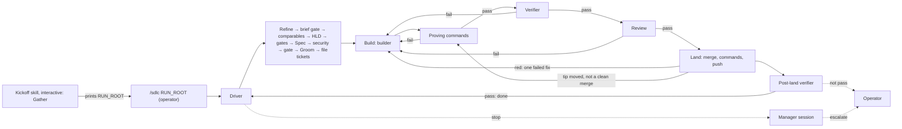

# HLD — solo-dlc: the SDLC on a harness without sub-agents

- Slug: `solo-dlc`
- Track / chunk ids: skills-home process track; chunk DER-421 (item 1
  already started as DER-529)
- Brief: DER-421 brief v3, confirmed by the operator 2026-10-18 (tracker
  copy: a comment on DER-421). This HLD is written from that brief only.
- Date: `2026-10-18`; fix rounds 1 and 2 after the adversarial
  reviews, same day
- Status: **draft, awaiting operator acceptance**

## Required

- **Problem** — The SDLC keeps its gates by giving separate jobs to
  separate agents: gatherer and refiner, designer and UX reviewer,
  builder, verifier, and reviewer. It assumes the host can mint and
  resume sub-agents. Vanilla Pi on one local model has no in-session
  sub-agents, and only one large-model session can run at a time. On
  that harness today the SDLC either collapses into one agent that
  grades its own work, or does not run.

- **Goals**
  1. Run the whole SDLC, every separate-agent gate and operator gate
     kept, on vanilla Pi with one local model of at least 100k tokens of
     context.
  2. Define the workflow once, as data, in a **bundle**. Our SDLC is the
     first bundle; others can be written with a bundle-authoring skill.
  3. One definition, two modes: **enforced** by a deterministic driver
     (Pi plugin first, then OpenCode), and **followed, not enforced** by
     an agent through a skill on harnesses with no plugin.
  4. No agent dispatches workers or runs the flow. `/sdlc` is a user
     command, not a tool declared to any model
     ([Trust boundaries](#trust-boundaries-hld-grain) says how far this
     is enforced).
  5. Stage results in one versioned format, with the exit taken
     restricted to the exits the flow allows.

- **Non-goals**
  - A coordinating agent that dispatches workers, or any model-callable
    tool that starts, steers, or stops the driver.
  - Running more than one large-model session at a time.
  - New SDLC steps, roles, tracker states, or tracker verbs.
  - Removing or weakening any gate. This path relocates some tracker
    writes and changes worker replacement; it removes none of them.
  - Trunk, Changelog, and Monthly inside the driver in this chunk; the
    driven run ends when every item is landed+verified on project-main.
  - Finding the run root from the previous transcript (later, per the
    brief).
  - A graphical console; see [ux.md](ux.md#not-this).
  - Sandboxing workers beyond what the harness gives (see Risks).
  - Per-verb tracker credentials. Most backends (for example, Linear)
    do not offer them; see [Tracker](#tracker).

- **Users / operators** — The **operator** runs the kickoff skill, types
  `/sdlc RUN_ROOT`, answers escalations, and holds every operator gate.
  **Workers** are harness processes, one per persona. The **manager**
  is a worker session resumed only on stops. **Bundle authors** write
  bundles. **Followed-mode agents** follow a bundle on a harness without
  a plugin. People and journeys: [ux.md](ux.md#people).

- **UX / stories** — [ux.md](ux.md) and
  [user-stories.md](user-stories.md) (designer). Agent review and
  operator acceptance: pending on that page. UX questions Q1 (replying
  to an escalation), Q2 (the followed-mode handoff form), and Q3 (the
  chronological index) stay **open** until the operator accepts the UX
  page. This HLD does not lock them; [Open](#open) lists each one with
  the default this HLD assumes and what changes if the operator picks
  otherwise.

- **Comparables** — [comparables.md](comparables.md): the Pi subagent
  example, OpenCode agents and the Task tool, Archon, LangGraph
  persistence.

## Shape

### Hierarchy (locked)

| Layer | Contains | One per |
| --- | --- | --- |
| Track → chunk (Epic) → item (Task, Bug) | As in [Tracker](../../../docs/SDLC.md#tracker), unchanged | — |
| **Bundle** | Flow file, personas, skills, scripts | Workflow definition, in git |
| **Flow file** | Nodes; each node's exits | Bundle |
| **Node** | One stage kind for one SDLC step: persona or command or gate, plus allowed exits | Flow file |
| **Run root** | One bundle instance: driver state, persona folders | Chunk |
| **Persona folder** | One worker's session and its run folders | Persona instance |
| **Run folder** `run-N/` | One invocation: prompt, result, prose, logs, `state.md` | Stage |

A **node** is the flow file's unit. Each node names one SDLC step from
[Names](../../../docs/SDLC.md#names), so `result.json` `step` stays a
step name. Several nodes can share a step: Plan has the comparables
node and the HLD node; Build has the builder node, the proving-command
node, and the verifier node. The UX console labels `Verify` and `Land`
are node names, not new steps.

### Bundle

A bundle is one folder:

```text
bundles/<bundle-id>/
  bundle.md        # what it is, flow summary, entry nodes, required skills
  flow.json        # nodes, exits, defaults (repo default proving commands)
  personas/<persona>.md   # front matter: tools, model slot, read-only flag;
                          # body: role prompt, skill ids to pack, state template
  skills/<id>/SKILL.md    # optional: skills owned only by this bundle
  scripts/                # optional: deterministic helpers a command node runs
```

- Our SDLC is `bundles/sdlc/`. Its personas reference skills in this
  home's `skills/<id>/` by id; the bundle copies no skill body, so each
  skill keeps one owner and one `SOURCES.md` pin. New skills the chunk
  needs (`test-failure-handler`, the bundle-authoring skill, the
  followed-mode skill, the kickoff skill) are ordinary first-party
  skills under `skills/`, each with a `SOURCES.md` row and a
  **security** cut. Final ids are fixed at Spec.
- Code lives under `packages/`: the core driver, the Pi plugin, and the
  OpenCode plugin, in TypeScript with Node built-ins only in the core.
- A bundle from a third party is loaded instructions: it goes through
  [INTAKE](../../../docs/INTAKE.md) before any harness runs it.

### Flow file

- `flow.json` is JSON with `schemaVersion`. JSON, because results are
  JSON, the driver validates it without a parser dependency, and a
  followed-mode agent can read it as is. Item 2 owns the schema.
- Each node has: `id`, `step`, `kind` (`model`, `command`, `gate`, or
  `land`), `scope` (`chunk` or `item`), the persona for `model` nodes,
  and `exits`. Each exit has a name, the statuses that may take it, and
  the next node. A node may also list required output paths and
  required check names.
- A result's `choice` must be an exit of that node whose status list
  holds the result's `status`. The driver rejects any other value as an
  invalid result. In followed mode, the skill applies the same rule.
- Two reserved exits exist on every node: `stop` (status `blocked` or
  `needs_input`: resume the manager) and `operator` (status
  `needs_input`, and the question is an operator gate). The bundle
  check rejects a flow that lists either one as a node exit.
- Command nodes have exactly one exit for `pass` and one for `fail`; the
  command wrapper sets `choice` from the exit code.
- A node's required output paths are repo-relative. The driver rejects
  a `pass` whose run folder lacks any of them.
- A node's required check names must each appear in a `pass` result's
  `evidence.checks`, each entry holding a finding or `n/a` and why. The
  driver rejects a `pass` that lacks one as an invalid result. The SDLC
  bundle's Review node requires the three **security** checks that
  [Review](../../../docs/sdlc/build-review.md#review) step 4 names:
  intake, SHA pins, and trust-boundary deltas.

**Bundle check.** Role skills decide forks (for example the
contrarian's fix or removal, a reviewer's approve or send back). The
flow file guarantees the gates. Before a run starts, the driver's
bundle check rejects a flow in which any path from the entry node:

| Reaches | Without passing, in this order |
| --- | --- |
| The HLD node | The comparables node |
| The Spec node | The Plan operator `gate` node |
| A Groom node or a Build node | The Spec node, the **security** node, and the Spec operator `gate` node |
| A `land` node, from a Build node | The proving-command node, the verifier node, and the Review node |

Each error names the node and exit ([ux.md](ux.md#journeys) J9). The
comparables node has `comparables.md` as its required output and the
HLD node has `hld.md`, so the comparables page exists before the HLD
is written.

The tip-merge re-check in
[Land](#land-and-post-land-verifier) step 1 runs inside the `land`
node, not on a flow path. It re-runs the proving commands and the
verifier only for a clean merge; any other change leaves the `land`
node for the proving-command node, so the last row still holds.

### Modes

| | Enforced | Followed, not enforced |
| --- | --- | --- |
| Who runs the flow | Deterministic driver in a harness plugin | An agent following the followed-mode skill, in the manager role |
| `choice` ∈ allowed exits | Driver rejects other values | Skill rule; the agent checks itself |
| Separate-agent gates | One harness process and session file per persona instance | One new session per persona instance, opened by the operator from the persona's handoff block and resumed for that persona's later passes. No waiver lets one session play two personas |
| Proving commands | Driver reads them from the committed `groom.md` blob and runs them | Agent reads them from the committed `groom.md` and runs them |
| Writable sets | Enforced or detected per [Writable sets and enforcement](#writable-sets-and-enforcement) | Skill rule |
| Run root, run folders, `result.json` | Same | Same |
| Every stop, prose, first line | — | States `followed, not enforced` |

"Followed, not enforced" means an agent, not a program, keeps the gates;
no program detects a deviation. The skill says so, the run says so, and
[Risks](#risks) lists it as residual risk.

**One definition.** The bundle is the single source of the workflow.
The flow spec (item 2) is the single owner of its semantics: node
kinds, exits, the reserved exits, required outputs and checks, and the
bundle check. The core driver implements that spec and is the only code
that interprets `flow.json`; the Pi and OpenCode plugins host the core
and supply a small harness adapter (start worker, resume worker,
install the worker extension, prompt the operator). The followed-mode
skill is the same algorithm in prose and routes to the flow spec
instead of restating it. A shared fixture set of flows and results
tests the core; the followed-mode skill's rules cite the same spec
sections.

### Driver

The driver is the [stage harness](../../../docs/sdlc/stage-result.md)
and the command wrapper for every stage. It decides nothing a role
skill decides.

1. On `/sdlc RUN_ROOT`, the driver takes the run-root lock
   (`driver/lock`); if another live driver holds it, it exits. It reads
   `run.json` and `driver.json`, reports what it found (last finished
   stage, interrupted run folder, sessions it will resume, next run
   folder), then continues ([ux.md](ux.md#journeys) J8).
2. It picks the next runnable node: chunk nodes in flow order; then
   items in plan order whose blockers are all landed+verified.
3. It opens a new run folder for the persona, writes `prompt.md` there,
   writes the facts file under `driver/facts/`, records the pre-stage
   hashes, and starts or resumes the worker.
4. It validates the worker's `candidate.json` against the stage-result
   contract, the node's exits, required outputs, and required checks;
   fixes `step` and `evidence.kind` from the invocation; and writes
   `result.json`. Invalid → one repair attempt: resume the same worker
   with the validation errors and a fixed prompt that only rewrites the
   candidate. Still invalid → write a `fail` result naming the cause,
   keep the invalid candidate, stop.
5. It runs the post-stage checks in
   [Writable sets and enforcement](#writable-sets-and-enforcement) and
   the tracker-state check in [Tracker](#tracker). A failed check →
   `fail` result naming the check, then an `operator` stop.
6. For a chunk node with required outputs, it commits those files into
   project-main per [Design-record commits](#design-record-commits).
7. It records the stage in the run's history (the format is UX Q3,
   open) and prints the console line
   ([ux.md](ux.md#high-level-ux)), then routes by `choice`.

- Workers run headless (`pi -p --mode json --session <file>`). `pi -p`
  exits 1 only when the model call fails, so the driver takes the
  outcome from the validated result, not from the exit code.
- The driver runs one worker process at a time. Command nodes also run
  one at a time. Items therefore build one after another, which the
  [Writable worktree](../../../docs/sdlc/subagents.md#writable-worktree)
  rule already allows.
- The core is a library with a thin CLI entry, so a plugin can run it
  in the command handler or as a detached child process. Which one the
  Pi plugin uses depends on the Trial (TUI use during a long handler).

### Run root and state

The run root is durable, outside the checkout, chosen at kickoff
(default under `$XDG_STATE_HOME/sdlc/<chunk-slug>/`). The driver refuses
a run root inside a git worktree. It deletes no run folder.

```text
RUN_ROOT/
  run.json           # bundle id and commit, repo, project-main, tracker, mode, persona → model
  driver.json        # driver-owned: node per item, repair counters, pending asks, hashes
  index.jsonl        # stage history, if the operator accepts UX Q3 as recommended
  checklist.md       # kickoff readiness checklist
  plan/items.json    # Groom snapshot: order, blockers, ticket ids, groom.md commit, command hash
  asks/ask-N.md      # escalation text and the operator's answer, verbatim
  driver/lock        # run-root lock
  driver/facts/      # facts passed to each worker start, one file per run folder
  worktrees/<ticket>/      # one item worktree
  worktrees/integrate/     # driver's integration worktree, on project-main
  <persona>/session.*      # the worker's harness session file
  <persona>/run-N/   # prompt.md, candidate.json, result.json, result.md (prose),
                     # state.md, out/ (files for the repo), logs/
```

- Chunk personas use their role name (`architect`, `refiner`,
  `designer`, `ux-reviewer`, `security`, `groom-reviewer`, `manager`).
  Item personas add the ticket, lowercased: `builder-abc-12`,
  `verifier-abc-12`, `reviewer-abc-12`, because
  [Item agents](../../../docs/sdlc/subagents.md#item-agents) belong to
  one item. The persona folder name is also its tracker agent label.
- `state.md` is a terse self-dump of at most one page. Each persona file
  has a state template. Builder: corrected errors, open findings,
  failures not to repeat. Verifier: a ledger of committed issues, each
  with a criticality; a re-check confirms they are fixed, raises a new
  issue only if it is breaking or critical, and records nits without
  sending them back. Workers keep `state.md` current during a run, not
  only at the end.
- **Compaction.** Pi auto-compacts when `contextTokens > contextWindow -
  reserveTokens`. The worker extension handles `session_before_compact`
  and supplies the summary: the persona header, the latest `state.md`
  (cut to one page), and a driver-facts block: open verifier issues and
  paths to failing logs. The driver passes the facts in an environment
  variable at process start and keeps the same text in `driver/facts/`.
  The extension reads only the environment variable. The worker's tool
  calls run as child processes of the Pi process, so they cannot change
  its environment (enforced by the operating system). The extension
  file lives in the installed plugin package, and the facts copy lives
  in `driver/facts/`; both are outside every writable set, and the
  hash check below covers both.

### Writable sets and enforcement

Each persona has a **writable set**: the only paths its tools may
change.

| Persona | Writable set |
| --- | --- |
| `builder-<ticket>` | Its current `run-N/` and `worktrees/<ticket>/` |
| Every other persona | Its current `run-N/` |

The harness itself writes the persona's own session file; that file is
outside the writable set and outside the hash check.

**Read-only personas** are the verifier, reviewer, refiner,
`ux-reviewer`, `security`, and `groom-reviewer`, plus any persona whose
front matter sets the read-only flag. They start with the harness's
write and edit tools denied.

The driver uses three harness controls. The current Pi CLI docs show
all three; whether Pi 0.73.1 has them is Trial question T6.

1. **Tool allowlist.** Read-only personas start with `--tools` naming
   only `read`, `grep`, `find`, `ls`, `bash`, and the extension's
   run-folder write tool. `write` and `edit` are not in the list.
2. **Run-folder write tool.** The worker extension registers one tool
   that writes a named file inside the persona's current `run-N/` and
   nowhere else. Read-only personas write `candidate.json`,
   `result.md`, `state.md`, and `out/` with it.
3. **Path guard.** The worker extension's `tool_call` handler blocks any
   `write` or `edit` call whose resolved path, symbolic links followed,
   is outside the persona's writable set. Pi blocks the call if the
   handler fails.

Every persona keeps `bash`: workers need it for git reads and the
tracker recipes. Pi does not path-guard `bash`, so a write through the
shell is caught only by the checks below.

| Claim | Kind | How, and what happens |
| --- | --- | --- |
| A worker writes only its writable set, through `write` or `edit` | Enforced | Tool allowlist and path guard |
| A worker writes only its writable set, through `bash` | Detected in the run root and item worktrees; residual elsewhere | Before each stage the driver hashes `run.json`, `driver.json`, `index.jsonl`, `plan/`, `asks/`, `driver/`, the worker extension file, and every persona folder except the current run folder and session file. After the stage it hashes them again. For each worktree outside the writable set, it compares `HEAD` and `git status --porcelain` before and after. Any change → `fail`, `operator` stop. Writes elsewhere on the machine are residual risk |
| The verifier and reviewer leave the item worktree unchanged | Detected | `HEAD`, `git status --porcelain`, and the remote item branch tip are compared before and after each verifier and reviewer stage. Any change → `fail`, `operator` stop |
| The builder does not change the proving commands | Enforced | The driver reads the commands only from the committed `groom.md` blob in its own integration worktree ([Verification](#verification-and-the-test-failure-path) step 2); an edit in the item worktree has no effect on what runs |
| The builder does not rewrite pushed history | Detected | Before it pushes the item branch, the driver checks that the last pushed tip is an ancestor of the new `HEAD`. If not → `fail`, `operator` stop |
| Only the driver pushes project-main | Detected for item work; residual otherwise | After each worker stage the driver fetches and checks that no commit of the item branch that it has not landed is reachable from project-main. If one is → `fail`, `operator` stop. Workers hold the operator's git credentials, so a worker push of other commits to project-main is residual risk |
| Workers do not start the driver | Enforced in part; residual in part | `/sdlc` is a plugin command, not a tool, and workers start with `--no-extensions`, so no worker session has it. The run-root lock stops a second driver on the same run root. A worker can still run `pi` from `bash` with another run root: residual risk |
| Driver facts reach the compaction summary unaltered | Enforced; detected | Environment variable (enforced); hash of `driver/facts/` and the extension file (detected) |
| Tracker writes follow the [Tracker](#tracker) table | Detected for state; residual for the rest | The tracker-state check in [Tracker](#tracker) |

### Workers and sessions

- Each worker is its own harness process, started with
  `--no-extensions`, `--no-skills`, and `-nc`, plus the worker extension
  and the persona's tool allowlist. Skills a persona needs are packed
  into `prompt.md`
  ([Spawn prompts](../../../docs/sdlc/subagents.md#spawn-prompts),
  Pack mode). The driver starts workers as child processes, not with
  `ctx.newSession()`, which replaces the host session.
- **Mint** = a new session file with only the crafted task.
  **Resume** = the same session file, delta-only prompt.
- Before every resume, the driver checks that the session file exists.
  Pi silently creates a new session at a missing path, so a missing
  file is a stop, not a resume into a blank session.
- The driver resumes the builder, verifier, and reviewer of an item
  across every pass on that item and does not replace them. Context
  pressure is handled by compaction, not by replacement. A lost or
  unloadable session file is a stop; the driver mints a replacement
  only on the operator's recorded answer, and passes it a short handoff
  per [Fallback](../../../docs/sdlc/subagents.md#fallback).
- Each item has one git worktree. The builder writes it; the verifier
  and reviewer read it ([Writable sets](#writable-sets-and-enforcement)).
- Groom sizes items to keep the builder's context reasonable for a 100k
  window. "Class-sized" is guidance, not a grain.
- A persona's model slot defaults to the run's local model. The
  reviewer may point at a different model. A review by the same model
  is a **cold review**: a different agent, not a different mind.

### Design-record commits

Chunk personas write only their run folder, so the driver commits their
repo files.

1. The persona writes each required output under its run folder's
   `out/`, at the repo-relative path the node names, and runs the
   [Plan](../../../docs/sdlc/plan-trial-spec.md#plan) step 4 scan on
   those files before it exits.
2. After a valid `pass`, the driver fetches, copies exactly the node's
   required output paths into its integration worktree, and runs a
   pattern scan for credentials, IPs, and local paths. A hit → `fail`,
   `operator` stop.
3. The driver commits with the Epic id and pushes project-main without
   force, per [Git on shared branches](#git-on-shared-branches).

### Verification and the test-failure path

1. Groom writes each item's proving commands into its entry in
   `groom.md`. The bundle may add repo defaults in `flow.json`.
2. After the tickets are filed, the driver records in `driver.json` the
   `groom.md` commit and a hash of every item's commands. Before every
   command run it reads the commands from that commit's `groom.md` blob
   in its integration worktree, with replace objects disabled, and
   compares their hash with the recorded one. A mismatch → `fail`,
   `operator` stop. It reads commands from no other copy:
   not `plan/items.json`, not the item worktree.
3. After each builder pass, the driver runs the commands in the item
   worktree as the command wrapper, one `result.json` per run, logs in
   the run folder.
4. A command fails → the driver resumes the builder with the log path
   and a fixed prompt that loads `test-failure-handler`. That skill
   opens the log, runs `debug` through root cause, fixes the failure,
   and records the lesson in `state.md`. The commands run again.
5. The model verifier runs only after every command passes. Verifier
   `fail` → back to the builder with the open ledger issues as driver
   facts → commands → verifier re-check.
6. Review: the reviewer loads `pr-review` and `security-hardening` and
   takes the diff range versus project-main. `fail` → back to the
   builder, then commands, verifier, and Review again.

**Repair budget.** Each item has one repair counter. A **failed fix**
is either of these events:

- A builder pass made after a check sent the item back (proving
  commands, verifier, reviewer, or the land commands), followed by any
  check sending the item back again.
- A red run of the proving commands on the integration merge
  ([Land](#land-and-post-land-verifier) step 3), whether or not the
  builder pass before it was a fix.

Each failed fix adds one; one event adds at most one. The counter
covers every check and does not reset, not even when a check passes.
When the third failed fix happens, the driver does not resume the
builder: it stops with the `operator` exit, an operator gate. An
invalid result gets one repair attempt (Driver step 4); that attempt
does not count as a fix.

### Land and post-land verifier

After the reviewer passes:

1. The driver fetches. If project-main's tip is unchanged since the item
   last merged it, go to step 2. If the tip moved, the driver resumes
   the builder with a fixed prompt to merge the tip into the item
   branch, pushes the item branch, and routes by what the builder did:

   | Builder outcome | Driver check | Next |
   | --- | --- | --- |
   | Clean tip merge | `git merge-tree --write-tree` of the previous item tip and the new project-main tip succeeds without conflicts, and its tree equals the tree of the item's new `HEAD` | The proving commands and the verifier re-run; then step 1 again |
   | Any file changed beyond a clean merge, such as a conflict resolution or another commit | The tree differs, or `merge-tree` reports a conflict | The usual path: proving commands, verifier, then Review; then step 1 again |
   | A conflict the builder cannot resolve | The builder's result is `blocked` | Stop, per [Stops and the manager](#stops-and-the-manager) |

   A `fail` on either path sends the item back to the builder as in
   [Verification](#verification-and-the-test-failure-path).
2. The driver merges the item into `integrate/<chunk-slug>` in its own
   integration worktree, at the fetched tip, with the ticket id and a
   `Reviewed-by: <reviewer-label> (<verdict>)` trailer.
3. It runs the proving commands on that merge, then routes:

   | Outcome | Next |
   | --- | --- |
   | Green, push accepted | Step 4 |
   | Green, push rejected because the tip moved | Discard the local merge (driver worktree only); return to step 1 |
   | Red | Discard the local merge. Resume the builder with the log path, as in [Verification](#verification-and-the-test-failure-path) step 4. Count one failed fix on the item's counter ([Repair budget](#verification-and-the-test-failure-path)); on the third, take the `operator` exit instead of resuming the builder. The builder's fix then takes the usual path: proving commands, verifier, Review, then step 1 |

   No path retries the same merge: a rejected push returns to step 1
   only because the tip moved, and a red run goes back through the
   builder and counts toward the repair budget.
4. It resumes the item's verifier with the land SHA and the command
   results.
5. Verifier `pass`: the verifier moves the item to `done` and comments
   the land SHA, its result, and the reviewer verdict. The driver reads
   the item's state; only when it reads `done` does the driver delete
   the item branch, remove the item worktree, and move to the next
   ready item. The manager is not woken for this.
6. Verifier `fail`, `blocked`, or `needs_input`: the verifier moves the
   item back to `in_progress` and comments its result; the driver stops
   with the `operator` exit. It leaves the pushed merge on
   project-main, keeps the item branch and worktree, and the item is
   not `done`. The operator decides what happens next. Items that
   depend on this one stay blocked; other runnable items continue.

Notify only when landed+verified: the console's `done` line follows
step 5.

### Git on shared branches

Other people and agents share project-main and the `tickets` branch.

- Fetch before every branch, every merge, and every push.
- Branch each item from the fetched project-main tip.
- Merge one item at a time; the driver runs one merge at a time.
- Push without force. A push rejected because the tip moved → fetch,
  redo the merge or commit on the new tip, push again; for a land, that
  is [Land](#land-and-post-land-verifier) step 1. The driver's push
  command has no force option.
- In-flight builders merge the tip into the item branch and never
  rebase a pushed branch (detected:
  [Writable sets](#writable-sets-and-enforcement)). The driver pushes
  the item branch after each builder pass.
- If the tip moved, the re-checks depend on the builder's merge, per
  [Land](#land-and-post-land-verifier) step 1: a clean merge re-runs
  the proving commands and the verifier; any other change also re-runs
  Review before land; a conflict the builder cannot resolve is a stop.
- Writes to the `tickets` branch go only through the `local` adapter's
  write recipe, which fetches, does not force-push, and retries only
  when the ref moved
  ([local adapter Safety rules](../../../skills/tracker-sdlc/adapters/local.md#safety-rules)).
  The driver's tracker reads fetch `tickets` first.

### Stops and the manager

The driver resumes the manager session when a stage is `blocked`,
returns `needs_input`, exhausts its repair budget, still gives an
invalid result after the repair attempt, fails a post-stage or
tracker-state check, or is a post-land verifier that does not pass.

1. The manager tries to answer from everything the project holds: the
   Gather sessions, the brief, the plan, the specs, and the tracker.
2. Its exits: `resume` (with the answer for the stopped worker),
   `defer` (park the item, pick another), or `escalate`.
3. These stops take the `operator` exit: a result that chooses
   `operator`, a `gate` node, a spent repair budget, a failed
   post-stage or tracker-state check, and a post-land verifier that
   does not pass. For them the driver offers the manager only
   `escalate` and rejects any other choice; the manager drafts the
   `ask-human.md` message.
4. The driver saves the ask in `asks/`, prints it, and keeps running
   other runnable work. When nothing is runnable, it returns. The next
   `/sdlc RUN_ROOT` shows the pending asks and records the answer
   verbatim. Whether the operator can also reply in the running
   console is UX Q1, open.
5. A `gate` node's result is written by the driver from the operator's
   recorded answer: `choice` is the exit the operator picked; `findings`
   holds the answer verbatim.

### Tracker

All tracker writes go through
[`tracker-sdlc`](../../../skills/tracker-sdlc/SKILL.md) and the product
repo's `.agents/tracker/SKILL.md`, with any backend. With no tracker
connected, the kickoff uses the existing `local` adapter (a `tickets`
branch); on a public repo that branch is public, onboarding says so
before writing, and the operator may name an alternative. The tracker
is chosen at onboarding or after Gather.

The driver writes nothing to the tracker. It reads ticket state with
the repo tracker skill's `read` command, run as a command with no model
(`local`: `git show origin/tickets:tickets/<id>.md` after a fetch). The
kickoff checklist requires that command; without it, the kickoff stops.

Each persona claims under its own agent label, the persona folder name
(for example `builder-abc-12`, `verifier-abc-12`). The manager's label
is `manager`.

**Comment fields.** Tracker comments are public. Every comment the run
writes, from a worker or the manager, carries exactly these fields:

- the ticket id (the Epic id for a chunk stage);
- the stage status;
- the run folder, relative to the run root (for example
  `verifier-abc-12/run-4/`).

Only the post-land verifier's `pass` comment adds three more: the land
SHA, its result, and the reviewer verdict. No comment holds an absolute
path, a log, a prompt, or Gather text ([ux.md](ux.md#high-level-ux),
SD-24). Claim markers keep the shape in
[`tracker-sdlc` Claim](../../../skills/tracker-sdlc/SKILL.md#claim).

| Persona | Writes, before it exits, whatever the outcome | State after the stage |
| --- | --- | --- |
| Builder, every pass | `claim` (claim steps 1–4); `comment` the comment fields | `in_progress` |
| Verifier, before land | `claim`; `comment` the comment fields, with the ledger verdict as the status | `in_progress` |
| Reviewer, every pass | `claim`; at the start, `transition` to `in_review` (claim step 5 first); `comment` the comment fields, with the verdict as the status | `in_review` |
| Verifier, post-land, `pass` | `claim`; `transition` to `done`; `comment` the comment fields plus the land SHA, its result, and the reviewer verdict | `done` |
| Verifier, post-land, not `pass` | `claim`; `transition` back to `in_progress`; `comment` the comment fields | `in_progress` |
| Step personas (architect, designer, …) | `comment` the comment fields on the Epic | Epic unchanged |
| Manager, ticket filing | `create` the Epic's tickets after the groom review passes; `set-blocker` | Each planned ticket exists in `backlog` under the Epic, with its planned blockers |
| Manager, stops | `comment` the comment fields on stops and escalations | Unchanged |

- **Claims across roles on one item are not collisions.** In claim
  steps 1 and 4, a marker or assignee whose label is `builder-`,
  `verifier-`, or `reviewer-` followed by the same lowercased ticket
  id counts as the claiming persona's own item, not another agent's.
  Any other label is a collision, handled by the claim steps as
  written.
- **Tracker-state check.** After each stage the driver reads the
  ticket's state, and its assignee where the read returns one, and
  compares them with the "State after the stage" column. Anything else
  is an unexpected transition: `fail`, `operator` stop. This is how the
  run detects a builder that moves an item to `in_review` or `done`.
- The builder's claim reads blockers first; an open blocker there is a
  `blocked` result, which cross-checks the driver's plan order.
- Per-verb tracker credentials are not generally available (for
  example, Linear has none), and this design does not require them.
  Workers hold the harness's full tracker access. A write the state
  check cannot see, such as comment text, a write to another ticket, or
  a change reverted before the check, is residual risk.

### Kickoff

A kickoff skill runs in a normal interactive session:

1. It readies the repo and plumbing: tracker choice and onboarding,
   project-main cut from trunk, and the readiness checklist, which
   includes the tracker `read` command.
2. It runs Gather (`discover-the-idea`) on the operator's brain dump.
3. It files the Epic, then initializes the run root: `run.json`, one
   folder per chunk persona, `gatherer/run-1/` holding the Gather
   output, and the first run folder for the refiner.
4. It prints the run root and the line `/sdlc RUN_ROOT`. The operator
   types it. If asked to start the run, the model says only the operator
   can type it.

The driver's first node is Refine. A refiner exit back to Gather is a
stop to the operator: continue Gather in the kickoff session, then type
`/sdlc RUN_ROOT` again. The operator confirms the brief at a `gate`
node.

### Trust boundaries (HLD grain)

- `/sdlc` is a user command, not a tool. How far that is enforced, and
  the residual risk, is in
  [Writable sets and enforcement](#writable-sets-and-enforcement).
- Ticket text, worker output, logs, and third-party bundles are data.
  The driver acts only on the validated result fields, `flow.json` from
  the pinned bundle commit, and the recorded operator answers. A
  third-party bundle passes intake before it runs.
- Proving commands come only from the reviewed, committed `groom.md`
  and the bundle's defaults; the driver re-hashes them from the git blob
  before each run.
- Workers run with the operator's shell rights and git credentials.
  Write and edit tools are allowlisted and path-guarded; `bash` is not.
  The post-stage checks detect shell writes in the run root and the
  worktrees; they do not prevent them.
- The run root holds logs that may contain tool output. It lives
  outside every checkout and is not committed or published; Plan step
  4's scan applies to anything copied from it.
- The driver puts no tracker or model credential in the run root,
  prompts, or facts. A worker can still print one into a log: residual
  risk.
- A reviewer on a paid model is spending and egress: an operator gate at
  kickoff, recorded in `run.json`.

## Gates kept

| SDLC gate | How this path keeps it |
| --- | --- |
| Operator confirms the brief | `gate` node after Refine |
| Gatherer ≠ refiner | Gather is the kickoff session; the refiner is a separate worker process |
| Comparables before Plan shape | Comparables node before the HLD node; the bundle check rejects a flow that skips it |
| UX review by a different agent; operator accepts or waives | `designer` and `ux-reviewer` personas, then a `gate` node |
| Operator accepts the Plan; Trial question | `gate` nodes at the end of Plan; the bundle check rejects a path to Spec that skips them |
| Spec entry: `tracker-sdlc` setup check | First check in the Spec node's prompt; failure is `blocked` |
| Security reviews the LLD; architect, security, then operator accept | `security` persona node, then a `gate` node; the bundle check rejects a path to Groom or Build that skips either |
| Groom: no ticket before a clean groom reviewer passes | `groom-reviewer` persona loop; ticket filing is a later manager node |
| No start past an open blocker | Plan order in the driver; the builder's claim reads blockers |
| Builder ≠ verifier ≠ reviewer; resume, never re-mint per loop | One persona folder and session file per role per item; the driver resumes each and replaces none without the operator |
| Proving commands and DoD | Driver-run commands, read from the committed `groom.md` blob; verifier checks DoD |
| Three failed fixes → operator | One counter per item that does not reset; the third failed fix takes the `operator` exit |
| Review before every land, with security reads | Bundle check: every Build-to-land path passes Verify then Review; a tip merge skips a second Review only when the driver finds it clean; a Review `pass` without the three security checks is an invalid result |
| Serialized lands, `Reviewed-by` trailer, no force-push | Driver land steps |
| `done` only after land + verify | Post-land verifier is the only persona whose expected state is `done`; the tracker-state check fails any other |
| Notify only when landed+verified | Console `done` line after the post-land verifier passes |
| Waivers in writing, security severity, destructive actions, spending | `operator` exit; the manager may only `escalate`; answers saved verbatim in `asks/` |
| Never proceed after silence; other items keep moving | Pending asks park their node; other runnable work continues |

## Rule changes

Each change applies only to a driven or followed bundle run. Item 3
writes them into one new owner file, `docs/sdlc/bundle-runs.md`, with a
one-line route from each current owner. Several owners are protected
rules in the [writing standard](../../writing-standard.md#protected-rules):
the item carries rule maps, the meaning question is answered by the
confirmed brief (2026-10-18) and this HLD's acceptance, and
**security** reads them at Review.

| Current rule | Owner | Change on this path |
| --- | --- | --- |
| Only the manager writes the tracker; builders, verifiers, and reviewers report | [SDLC Tracker](../../../docs/SDLC.md#tracker), [subagents Tracker writes](../../../docs/sdlc/subagents.md#tracker-writes) | Workers write per the [Tracker](#tracker) table; prompts carry tracker instructions |
| Every tracker read goes through `tracker-sdlc` by an agent | [SDLC Tracker](../../../docs/SDLC.md#tracker) | The driver also runs the repo tracker skill's `read` command itself, with no model, for the tracker-state check |
| The manager claims under the label it assigns, before minting or resuming a builder; the agent never claims | [Build](../../../docs/sdlc/build-review.md#build), [`tracker-sdlc` Claim](../../../skills/tracker-sdlc/SKILL.md#claim) | Each persona claims under its own label, the persona folder name |
| Claim steps 1 and 4: any other agent's marker is a collision | [`tracker-sdlc` Claim](../../../skills/tracker-sdlc/SKILL.md#claim) | A `builder-`, `verifier-`, or `reviewer-` label with the same ticket id is the same item, not a collision |
| The manager transitions the item to `in_review` when Review starts | [Review](../../../docs/sdlc/build-review.md#review) step 1 | The reviewer does, at the start of each pass. The operator's direction: the last persona in the loop does the paperwork rather than waking the manager |
| The manager marks `done` and comments land SHA, verifier result, verdict | [Land path](../../../docs/sdlc/branches-and-lands.md#land-path) | The post-land verifier does; the driver deletes the item branch only after it reads `done` |
| The manager posts the HLD and LLD path on the Epic | [Plan](../../../docs/sdlc/plan-trial-spec.md#plan) step 7, Spec step 3 | The architect comments on the Epic with only the [Tracker](#tracker) comment fields; the run folder it names holds the HLD or LLD under `out/` at its repo-relative path |
| The architect commits and pushes Plan and Spec drafts | [Plan](../../../docs/sdlc/plan-trial-spec.md#plan) steps 3, 5, 6; Spec step 2 | The architect writes them to its run folder and scans them; the driver commits and pushes ([Design-record commits](#design-record-commits)) |
| The manager sets the land order | [Land path](../../../docs/sdlc/branches-and-lands.md#land-path) | The driver follows the Groom plan order |
| After an item lands, in-flight builders rebase or merge project-main | [Branches](../../../docs/sdlc/branches-and-lands.md#branches) | In-flight builders merge project-main into the item branch and never rebase a pushed branch ([Git on shared branches](#git-on-shared-branches)) |
| The landing builder de-conflicts against the project-main tip; then its verifier is resumed | [Branches](../../../docs/sdlc/branches-and-lands.md#branches), [Project-main](../../../docs/sdlc/branches-and-lands.md#project-main) | Per the manager's ruling: a clean tip merge re-runs only the proving commands and the verifier; any change beyond a clean merge, such as a conflict resolution, also re-runs Review before land; a conflict the builder cannot resolve is a stop ([Land](#land-and-post-land-verifier) step 1) |
| Resume fails, or a transcript passes half the window or is compacted → replace the agent | [Fallback](../../../docs/sdlc/subagents.md#fallback) | Not replaced; compaction from `state.md`; a lost session is a stop and only the operator approves a replacement |
| Three failed fixes → stop and ask the operator | [`debug`](../../../skills/debug/SKILL.md) phase 4, [Asking the operator](../../../docs/SDLC.md#asking-the-human) | One counter per item, across every check, that does not reset; a red run of the land proving commands counts as a failed fix; the third failed fix is the operator gate |
| Model stage: absent or invalid output → harness emits `fail` | [Stage result](../../../docs/sdlc/stage-result.md#rules) | One repair attempt first, then `fail` |
| Schema has four top-level fields | [Stage result](../../../docs/sdlc/stage-result.md#schema) | Adds `schemaVersion`, `choice`, `ticket`, `artifact` (item 1, in place) |

Item 1's fields: `schemaVersion` is the integer `1`. `choice` is a
non-empty string, one of the node's allowed exits for that status.
`ticket` is the id the repo's tracker skill returns, for any backend,
including `local`; chunk-scope stages use the Epic id. `artifact` is one
path relative to the run root: the result document or the output folder
in the stage's run folder (for example `architect/run-3/out/`); an
absolute path, or one that leaves the run root, is a failure. The
`Out of scope` line of `stage-result.md` stops excluding the flow file
and points at the flow spec instead.

## Persistence

| What | Where | Durable because |
| --- | --- | --- |
| Bundles, flow files, personas, skills, packages, these design records, `groom.md` with proving commands | Git, this repo | Designs in git from onset |
| Product code, docs, changelog | Git: item branches, then project-main | Pushed as built; pushed after each land |
| Epic, items, blockers, claims, comments, `done` | Tracker through `tracker-sdlc` (any backend; `local` = `tickets` branch) | The board |
| Driver position, sessions, run folders, asks, logs, worktrees | Run root, outside the checkout | Kept across crashes; the driver deletes no run folder |

If git and the run root disagree, git and the tracker win for what
landed; the run root wins for what ran. A lost run root loses the worker
sessions, not the work: every resume stops and the operator decides.

## Worker rules

- Only the operator starts the driver. Workers do not call `/sdlc`;
  what enforces this, and the residual risk, is in
  [Writable sets and enforcement](#writable-sets-and-enforcement).
- One large-model worker process at a time.
- Each worker writes only its writable set. Read-only personas start
  without write and edit tools.
- Workers leave proving commands, `flow.json`, `driver.json`, and other
  persona folders unchanged; they write their own run folder instead.
  Each is enforced or detected per the same section.
- Workers do not bypass **security**: the Spec security node and the
  Review security checks are flow nodes and required checks that the
  bundle check and result validation enforce.
- Tracker writes only per the [Tracker](#tracker) table, only through
  `tracker-sdlc`.
- The driver runs no destructive git: no force-push, no remote reset;
  it deletes only an item branch whose item reads `done`, per the land
  path.
- HITL: operator gates listed in [Gates kept](#gates-kept); the manager
  answers everything else from the project or escalates.

## Items

Order and blockers from the brief. Groom writes the tickets, the
proving commands, and the final blocker reasons.

| # | Item | Blocked by | Reason |
| --- | --- | --- | --- |
| 1 | Result-format update (DER-529, `stage-result.md` in place) | none | — |
| 2 | Bundle and flow spec | 1 | `choice` semantics use item 1's fields |
| 3 | SDLC as the first bundle: personas, state templates, `test-failure-handler`, tracker wiring, `bundle-runs.md` | 2 | Written in the flow spec's format |
| 5 | Core driver | 1, 2 | Implements both specs |
| 6 | Pi plugin | 3, 5 | Hosts the core; proves the Pi path on the SDLC bundle |
| 4 | Bundle-authoring skill | 6 | Brief: after the Pi path works |
| 7 | OpenCode plugin | 6 | Brief: after the Pi path works |
| 8 | Followed-mode skill and kickoff skill | 6 | Brief: after the Pi path works |

Waves: 1 → 2 → 3, 5 → 6 → 4, 7, 8. Until item 8 lands, the Pi path is
proven on a run root that item 6's tests create directly.

## Chunk record

- Type: Epic DER-421. project-main: `integrate/solo-dlc`. Land path:
  merge-and-delete after explicit Review, local and serialized; no
  internal PRs.
- HLD: this file. LLD: n/a until Spec. Groom:
  `maintainers/design/solo-dlc/groom.md` (frozen once tickets exist).
- Why now: the operator's first target harness is vanilla Pi on one
  local model, which cannot run the SDLC's separate-agent gates today.
- Done: project-main on trunk; every item landed+verified.
- Children: DER-529 (item 1); others at Groom. Blocked by: none.
  Blocks: none.

## Open

- **UX Q1, replying to an escalation (open).** This HLD assumes only
  the fallback that always works: the next `/sdlc RUN_ROOT` shows
  pending asks and records the answer. If the operator accepts the
  console reply and Trial T1 shows the TUI stays usable, the driver also
  takes the answer in the running console.
- **UX Q2, followed-mode handoff (open).** The separation is fixed:
  one new session per persona instance, no waiver. Open is only the
  form of the handoff block (persona, run folder, prompt to paste).
- **UX Q3, chronological index (open).** This HLD assumes one
  `index.jsonl` line per stage at the run root. If the operator rejects
  it, resume reads the persona folders instead and Driver step 7
  records nothing extra.
- Not confirmed (brief): whether `pi -p "/sdlc …"` runs a command
  headlessly; whether the TUI stays usable during a long command
  handler; how the OpenCode server behaves.
- Not confirmed (this HLD): that a worker started with `--no-extensions`
  can still load the worker extension, and that
  `session_before_compact` fires in `-p` mode; that `--tools`, a
  `tool_call` block, and an extension-registered tool work in Pi 0.73.1
  as the current docs describe; that the local model writes a valid
  `candidate.json` often enough with one repair.
- Not confirmed: that every supported backend's tracker skill can name
  a non-interactive `read` command. `local` can; confirm others,
  starting with Linear, at onboarding for the repo that uses them.
- Agent labels must match `^[a-z0-9][a-z0-9-]{0,31}$`, so the longest
  label, `reviewer-<ticket>`, limits ticket id length to 23 characters.
  Spec says what the kickoff does with a longer id.
- The exact flow-file schema, file names inside run folders, console
  wording, and skill ids: Spec.
- OpenCode server behavior: checked before item 7 starts.

## Optional

### Sketch



### Alternatives rejected

- **A coordinating agent** dispatching workers: ruled out by the brief;
  a model would hold the gates.
- **`ctx.newSession()` for workers**: replaces the host session.
- **Fresh context per pass** (Archon's `fresh_context`): loses the
  builder's memory of the item; the brief requires resume.
- **Replacing a worker on context pressure** (current Fallback):
  replaced by compaction from `state.md`, per the brief.
- **A DAG flow** (`depends_on`): Build, Verify, and Review loop, so
  exits per node fit; the bundle check replaces acyclicity.
- **YAML flow file**: needs a parser dependency in the core and a second
  format beside JSON results.
- **Driver writing the tracker directly**: bypasses `tracker-sdlc` and
  ties the driver to backends. The driver only reads state, through the
  repo skill's own `read` command.
- **Per-verb tracker credentials**: most backends, for example Linear,
  do not offer them; the tracker-state check stands in.
- **Dropping the comparables ordering claim**: would weaken a gate; one
  extra node keeps it.
- **Bundles copying skill bodies**: two owners per skill, and pins drift.
- **New step names `Verify` and `Land`**: would change the SDLC's
  Names; nodes carry existing step names instead.

### Risks

- A local model may produce invalid results or weak reviews often;
  one repair and the manager stop bound the cost, not the quality.
- Workers have full shell rights and the operator's git credentials.
  `bash` is not path-guarded: writes outside the run root and the
  worktrees, and pushes of commits other than item work to
  project-main, go undetected. Security reads this at Spec.
- A worker can start `pi` from `bash` with a different run root; the
  run-root lock covers only the same root.
- Workers hold full tracker access. The tracker-state check sees states
  and assignees, not comment text, writes to other tickets, or a change
  reverted before the check.
- A worker can print a credential into a log in the run root.
- Followed mode: an agent keeps the gates, including one session per
  persona; no program detects a deviation.
- Pi 0.73.1 may lack the tool allowlist, the `tool_call` block, or
  extension tools (Trial T6). Then read-only personas rely on detection
  alone until Spec finds another control.
- Serial execution is slow on large chunks; Groom sizing matters more.
- Cold review shares the builder model's blind spots; the reviewer slot
  can point at another model, at the cost of a spending gate.
- More tracker writers mean more chances of a failed write; every write
  still goes through `tracker-sdlc` Runtime rules.
- A public `tickets` branch exposes ticket text; onboarding warns.

### PoC questions (Trial)

See [Trial question](#trial-question).

## Trial question

**For the operator.** Should a Trial run before Spec? A Trial is an
optional, throwaway proof under `maintainers/design/solo-dlc/poc/`; it
is a frozen record, not product code.

**Recommendation: yes, a narrow Pi-only Trial.** The driver's hosting
model rests on behavior the brief marks as not confirmed: whether the
TUI stays usable during a long command handler, and whether `pi -p
"/sdlc …"` runs a command headlessly. The worker model rests on more
unconfirmed points: loading one extension under `--no-extensions`,
`session_before_compact` firing in `-p` mode, and the tool allowlist,
`tool_call` block, and extension tool that the writable sets rely on.
If any fails, Spec picks a different host shape (detached driver
process), compaction path, or write control; finding that out in item
6 would rework items 5 and 6. The OpenCode server question waits until
before item 7; it does not block the Pi path.

If the operator says no, Spec assumes the detached-driver shape and
item 6 carries these checks as its first acceptance tests.

## Trial kickoff prompt

> You are the **architect** for chunk DER-421 (`solo-dlc`) at the SDLC
> Trial step, in the skills-home repo, on `integrate/solo-dlc`. Read
> `maintainers/design/solo-dlc/hld.md` and
> [Trial](../../../docs/sdlc/plan-trial-spec.md#trial). Write only under
> `maintainers/design/solo-dlc/poc/`: `poc.md` from template `poc.md`,
> `README.md` stating the two Trial rules (frozen record, not imported
> into product paths), and the trial code beside them. Link to
> sources; copy no vendored dependency or build output. Commit and push
> each file as written, after the Plan step 4 scan; push without force.
>
> Use `@mariozechner/pi-coding-agent` 0.73.1 and one local model with a
> context of at least 100k tokens. Spend no money; use no paid model.
>
> Prove or disprove, recording commands, versions, and observed output:
>
> 1. **T1 Command handler.** A Pi extension registers `/sdlc` with
>    `pi.registerCommand`. Its handler starts a child `pi -p --mode json
>    --session <file>` worker and waits for it. Record whether the TUI
>    stays usable while the handler runs for several minutes, and
>    whether the handler can prompt the operator and get an answer.
> 2. **T2 Headless command.** Whether `pi -p "/sdlc <root>"` runs the
>    command handler with no TUI.
> 3. **T3 Resume.** Resume a worker with `--session <file>` across three
>    passes and show it keeps its context. Show the missing-file case
>    creates a new session, and that a pre-resume existence check stops
>    it.
> 4. **T4 Compaction.** Start a worker with `--no-extensions`,
>    `--no-skills`, `-nc`, plus one explicit extension. Show whether the
>    extension loads, whether `session_before_compact` fires in `-p`
>    mode when `contextTokens > contextWindow - reserveTokens`, and
>    whether its custom summary (a `state.md` plus facts from an
>    environment variable) replaces the default.
> 5. **T5 Results.** Give the local model a fixed task and a
>    stage-result schema with `choice` limited to two exits. Over at
>    least 10 runs, count valid `candidate.json` files first time and
>    after one repair prompt.
> 6. **T6 Write controls.** On the same worker setup as T4, show
>    whether: `--tools read,grep,find,ls,bash,<ext-tool>` removes
>    `write` and `edit` from the model's tools; the extension can
>    register `<ext-tool>`, a tool that writes only inside one folder;
>    and a `tool_call` handler can block a `write` or `edit` call whose
>    path, symbolic links resolved, is outside an allowed set, including
>    when the handler throws.
>
> For each question, write the verdict (works, fails, works with a
> named condition) and what the HLD or Spec must change. Do not write
> the LLD. Do not write to the tracker. When done, report to the
> manager: the commit SHAs pushed, the `poc/` paths, each verdict, and
> any HLD change you recommend, as an `ask-human.md`-ready summary.
