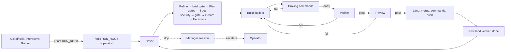

# HLD — solo-dlc: the SDLC on a harness without sub-agents

- Slug: `solo-dlc`
- Track / chunk ids: skills-home process track; chunk DER-421 (item 1
  already started as DER-529)
- Brief: DER-421 brief v3, confirmed by the operator 2026-10-18 (tracker
  copy: a comment on DER-421). This HLD is written from that brief only.
- Date: `2026-10-18`
- Status: **draft, awaiting operator acceptance**

## Required

- **Problem** — The SDLC keeps its gates by giving separate jobs to
  separate agents: gatherer and refiner, designer and UX reviewer,
  builder, verifier, and reviewer. It assumes the host can mint and
  resume sub-agents. Vanilla Pi on one local model has no in-session
  sub-agents, and only one large-model session can run at a time. On
  that harness today the SDLC either collapses into one agent that
  grades its own work, or does not run.

- **Goals**
  1. Run the whole SDLC, every separate-agent gate and operator gate
     kept, on vanilla Pi with one local model of at least 100k tokens of
     context.
  2. Define the workflow once, as data, in a **bundle**. Our SDLC is the
     first bundle; others can be written with a bundle-authoring skill.
  3. One definition, two modes: **enforced** by a deterministic driver
     (Pi plugin first, then OpenCode), and **followed, not enforced** by
     an agent through a skill on harnesses with no plugin.
  4. No orchestrator agent. `/sdlc` is a user command, never a tool the
     model can call.
  5. Stage results in one versioned format, with the exit taken
     restricted to the exits the flow allows.

- **Non-goals**
  - An orchestrator agent, or any model-callable tool that starts,
    steers, or stops the driver.
  - Running more than one large-model session at a time.
  - New SDLC steps, roles, tracker states, or tracker verbs.
  - Removing or weakening any gate. This path relocates some tracker
    writes and changes worker replacement; it removes none of them.
  - Trunk, Changelog, and Monthly inside the driver in this chunk; the
    driven run ends when every item is landed+verified on project-main.
  - Finding the run root from the previous transcript (later, per the
    brief).
  - A graphical console; see [ux.md](ux.md#not-this).
  - Sandboxing workers beyond what the harness gives (see Risks).

- **Users / operators** — The **operator** runs the kickoff skill, types
  `/sdlc RUN_ROOT`, answers escalations, and holds every operator gate.
  **Workers** are harness processes, one per persona. The **manager**
  is a worker session resumed only on stops. **Bundle authors** write
  bundles. **Followed-mode agents** follow a bundle on a harness without
  a plugin. People and journeys: [ux.md](ux.md#people).

- **UX / stories** — [ux.md](ux.md) and
  [user-stories.md](user-stories.md) (designer). Agent review and
  operator acceptance: pending on that page. This HLD adopts the UX
  page's recommendations for Q1 (replying to an escalation), Q2
  (followed-mode handoff), and Q3 (chronological index) as stated in
  [Shape](#shape); the operator can still overturn them there.

- **Comparables** — [comparables.md](comparables.md): the Pi subagent
  example, OpenCode agents and the Task tool, Archon, LangGraph
  persistence.

## Shape

### Hierarchy (locked)

| Layer | Contains | One per |
| --- | --- | --- |
| Track → chunk (Epic) → item (Task, Bug) | As in [Tracker](../../../docs/SDLC.md#tracker), unchanged | — |
| **Bundle** | Flow file, personas, skills, scripts | Workflow definition, in git |
| **Flow file** | Nodes; each node's exits | Bundle |
| **Node** | One stage kind for one SDLC step: persona or command or gate, plus allowed exits | Flow file |
| **Run root** | One bundle instance: driver state, persona folders | Chunk |
| **Persona folder** | One worker's session and its run folders | Persona instance |
| **Run folder** `run-N/` | One invocation: prompt, result, prose, logs, `state.md` | Stage |

A **node** is the flow file's unit. Each node names one SDLC step from
[Names](../../../docs/SDLC.md#names), so `result.json` `step` stays a
step name. Several nodes can share a step: Build has the builder node,
the proving-command node, and the verifier node. The UX console labels
`Verify` and `Land` are node names, not new steps.

### Bundle

A bundle is one folder:

```text
bundles/<bundle-id>/
  bundle.md        # what it is, flow summary, entry nodes, required skills
  flow.json        # nodes, exits, defaults (repo default proving commands)
  personas/<persona>.md   # front matter: tools, model slot, read-only flag;
                          # body: role prompt, skill ids to pack, state template
  skills/<id>/SKILL.md    # optional: skills owned only by this bundle
  scripts/                # optional: deterministic helpers a command node runs
```

- Our SDLC is `bundles/sdlc/`. Its personas reference skills in this
  home's `skills/<id>/` by id; the bundle copies no skill body, so each
  skill keeps one owner and one `SOURCES.md` pin. New skills the chunk
  needs (`test-failure-handler`, the bundle-authoring skill, the
  followed-mode skill, the kickoff skill) are ordinary first-party
  skills under `skills/`, each with a `SOURCES.md` row and a
  **security** cut. Final ids are fixed at Spec.
- Code lives under `packages/`: the core driver, the Pi plugin, and the
  OpenCode plugin, in TypeScript with Node built-ins only in the core.
- A bundle from a third party is loaded instructions: it goes through
  [INTAKE](../../../docs/INTAKE.md) before any harness runs it.

### Flow file

- `flow.json` is JSON with `schemaVersion`. JSON, because results are
  JSON, the driver validates it without a parser dependency, and a
  followed-mode agent can read it as is. Item 2 owns the schema.
- Each node has: `id`, `step`, `kind` (`model`, `command`, `gate`, or
  `land`), `scope` (`chunk` or `item`), the persona for `model` nodes,
  and `exits`. Each exit has a name, the statuses that may take it, and
  the next node.
- A result's `choice` must be an exit of that node whose status list
  holds the result's `status`. The driver rejects any other value as an
  invalid result. In followed mode, the skill applies the same rule.
- Two reserved exits exist on every node and are never listed:
  `stop` (status `blocked` or `needs_input`: resume the manager) and
  `operator` (status `needs_input`, and the question is an operator
  gate: the manager drafts the ask and cannot answer it).
- Command nodes have exactly one exit for `pass` and one for `fail`; the
  command wrapper sets `choice` from the exit code.
- Role skills decide forks (for example the contrarian's fix or
  removal, a reviewer's approve or send back). The flow file guarantees
  the gates: the driver's bundle check rejects a flow where any path
  from a Build node reaches a `land` node without passing the
  proving-command node, the verifier node, and the Review node, in that
  order. Errors name the node and exit ([ux.md](ux.md#journeys) J9).
- A node may list required output paths; the driver rejects a `pass`
  whose paths are missing. Plan uses this for `hld.md` and
  `comparables.md`, so comparables come first.

### Modes

| | Enforced | Followed, not enforced |
| --- | --- | --- |
| Who runs the flow | Deterministic driver in a harness plugin | An agent following the followed-mode skill |
| `choice` ∈ allowed exits | Driver rejects other values | Skill rule; the agent checks itself |
| Separate-agent gates | Separate processes and session files; driver never shares one | Handoff block per separate-agent node; the operator opens a new session for it (UX Q2). One session plays two separated personas only with a written operator waiver, saved in the run folder |
| Proving commands | Driver runs them; builder cannot edit | Agent runs them from the plan snapshot |
| Verifier and reviewer read-only | Driver checks the worktree is unchanged | Skill rule |
| Run root, run folders, `result.json` | Same | Same |
| Every stop, prose, first line | — | States `followed, not enforced` |

"Followed, not enforced" means an agent, not a program, keeps the gates;
nothing stops it from deviating. The skill says so, and the run says so.

**One definition.** The bundle is the single source of the workflow.
The flow spec (item 2) is the single owner of its semantics: node
kinds, exits, the reserved exits, and the Build-to-land path rule. The
core driver implements that spec and is the only code that interprets
`flow.json`; the Pi and OpenCode plugins host the core and supply a
small harness adapter (start worker, resume worker, install the
compaction hook, prompt the operator). The followed-mode skill is the
same algorithm in prose and routes to the flow spec instead of
restating it. A shared fixture set of flows and results tests the core;
the followed-mode skill's rules cite the same spec sections.

### Driver

The driver is the [stage harness](../../../docs/sdlc/stage-result.md)
and the command wrapper for every stage. It decides nothing a role
skill decides.

1. On `/sdlc RUN_ROOT`, the driver reads `run.json` and `driver.json`,
   reports what it found (last finished stage, interrupted run folder,
   sessions it will resume, next run folder), then continues
   ([ux.md](ux.md#journeys) J8).
2. It picks the next runnable node: chunk nodes in flow order; then
   items in plan order whose blockers are all landed+verified.
3. It opens a new run folder for the persona, writes `prompt.md` and
   `facts.json`, and starts or resumes the worker.
4. It validates the worker's `candidate.json` against the stage-result
   contract and the node's exits, fixes `step` and `evidence.kind` from
   the invocation, and writes `result.json`. Invalid → one repair
   attempt: resume the same worker with the validation errors and a
   fixed prompt that only rewrites the candidate. Still invalid → write
   a `fail` result naming the cause, keep the invalid candidate, stop.
5. For a verifier or reviewer, it checks the item worktree's `HEAD` and
   `git status` are unchanged. Any change → invalid result, stop.
6. It appends one line to `index.jsonl` (UX Q3) and prints the console
   line ([ux.md](ux.md#high-level-ux)), then routes by `choice`.

- Workers run headless (`pi -p --mode json --session <file>`). `pi -p`
  exits 1 only when the model call fails, so the driver never reads the
  outcome from the exit code; the outcome is the validated result.
- The driver runs one worker process at a time. Command nodes also run
  one at a time. Items therefore build one after another, which the
  [Writable worktree](../../../docs/sdlc/subagents.md#writable-worktree)
  rule already allows.
- The core is a library with a thin CLI entry, so a plugin can run it
  in the command handler or as a detached child process. Which one the
  Pi plugin uses depends on the Trial (TUI use during a long handler).

### Run root and state

The run root is durable, outside the checkout, chosen at kickoff
(default under `$XDG_STATE_HOME/sdlc/<chunk-slug>/`). Old runs are kept.

```text
RUN_ROOT/
  run.json           # bundle id and commit, repo, project-main, tracker, mode, persona → model
  driver.json        # driver-owned: node per item, repair counters, pending asks, file hashes
  index.jsonl        # one line per stage: time, ticket, node, persona, run folder, status, choice
  checklist.md       # kickoff readiness checklist
  plan/items.json    # Groom snapshot: order, blockers, proving commands, groom.md commit
  asks/ask-N.md      # escalation text and the operator's answer, verbatim
  worktrees/<ticket>/      # one item worktree
  worktrees/integrate/     # driver's integration worktree
  <persona>/session.*      # the worker's harness session file
  <persona>/run-N/   # prompt.md, facts.json, candidate.json, result.json,
                     # result.md (prose), state.md, logs/
```

- Chunk personas use their role name (`architect`, `refiner`,
  `designer`, `ux-reviewer`, `security`, `groom-reviewer`, `manager`).
  Item personas add the ticket, lowercased: `builder-abc-12`,
  `verifier-abc-12`, `reviewer-abc-12`, because the SDLC never reuses an
  item's agents on another item.
- `state.md` is a terse self-dump of at most one page. Each persona file
  has a state template. Builder: corrected errors, open findings,
  failures not to repeat. Verifier: a ledger of committed issues, each
  with a criticality; a re-check confirms they are fixed, raises a new
  issue only if it is breaking or critical, and records nits without
  sending them back. Workers keep `state.md` current during a run, not
  only at the end.
- **Compaction.** Pi auto-compacts when `contextTokens > contextWindow -
  reserveTokens`. A small worker-only extension handles
  `session_before_compact` and supplies the summary: the persona
  header, the latest `state.md` (cut to one page), and a driver-facts
  block. The driver passes those facts at process start in an
  environment variable: open verifier issues and paths to failing logs.
  The worker cannot change the running extension's environment, so it
  cannot remove the facts.

### Workers and sessions

- Each worker is its own harness process, started with
  `--no-extensions`, `--no-skills`, and `-nc`, plus the compaction
  extension. Skills a persona needs are packed into `prompt.md`
  ([Spawn prompts](../../../docs/sdlc/subagents.md#spawn-prompts),
  Pack mode). Workers are never started with `ctx.newSession()`, which
  replaces the host session.
- **Mint** = a new session file with only the crafted task.
  **Resume** = the same session file, delta-only prompt.
- Before every resume, the driver checks that the session file exists.
  Pi silently creates a new session at a missing path, so a missing
  file is a stop, never a resume into a blank session.
- The builder, verifier, and reviewer of an item are each resumed across
  every pass on that item and never replaced. Context pressure is
  handled by compaction, not by replacement. A lost or unloadable
  session file is a stop; only the operator can approve minting a
  replacement, which then gets a short handoff per
  [Fallback](../../../docs/sdlc/subagents.md#fallback).
- Each item has one git worktree. The builder writes it; the verifier
  and reviewer read it and never write it.
- Groom sizes items to keep the builder's context reasonable for a 100k
  window. "Class-sized" is guidance, not a grain.
- A persona's model slot defaults to the run's local model. The
  reviewer may point at a different model. A review by the same model
  is a **cold review**: a different agent, not a different mind.

### Verification and the test-failure path

1. Groom writes each item's proving commands into its entry in
   `groom.md`. The bundle may add repo defaults in `flow.json`.
2. After the tickets are filed, the driver snapshots every item's
   commands into `plan/items.json` with the `groom.md` commit and
   records its hash. It never reads commands from the item worktree, so
   the builder cannot edit them.
3. After each builder pass, the driver runs the commands in the item
   worktree as the command wrapper, one `result.json` per run, logs in
   the run folder.
4. A command fails → the driver resumes the builder with the log path
   and a fixed prompt that loads `test-failure-handler`. That skill
   opens the log, runs `debug` through root cause, fixes the failure,
   and records the lesson in `state.md`. The commands run again.
5. The model verifier runs only after every command passes. Verifier
   `fail` → back to the builder with the open ledger issues as driver
   facts → commands → verifier re-check.
6. Review: the reviewer loads `pr-review` and `security-hardening` and
   takes the diff range versus project-main. `fail` → back to the
   builder, then commands, verifier, and Review again.

**Repair budget.** Three failed fixes per item and per sending check: a
fix fails when the check that sent the item back fails again after the
fix. The counter resets when that check passes. The third failed fix is
a stop and an operator gate. An invalid result gets one repair attempt
(Driver step 4).

### Land and post-land verifier

After the reviewer passes:

1. The driver fetches. If project-main's tip moved since the item last
   merged it, the driver resumes the builder with a fixed prompt to
   merge the tip; then the commands and the verifier re-run. Repeat
   until the tip is unchanged.
2. The driver merges the item into `integrate/<chunk-slug>` in its own
   integration worktree, at the fetched tip, with the ticket id and a
   `Reviewed-by: <reviewer-label> (<verdict>)` trailer.
3. It runs the proving commands on that merge. Green → push without
   force. Red, or push rejected → discard the local merge (driver
   worktree only) and go back to step 1.
4. It resumes the item's verifier with the land SHA and the command
   results. The verifier confirms the result, moves the item to `done`,
   and comments the land SHA, its result, and the reviewer verdict.
5. The driver deletes the item branch, removes the item worktree, and
   moves to the next ready item. The manager is not woken for this.

Notify only when landed+verified: the console's `done` line follows
step 4.

### Git on shared branches

Other people and agents share project-main and the `tickets` branch.

- Fetch before every branch and every merge.
- Branch each item from the fetched project-main tip.
- Merge one item at a time; never race two merges.
- Never force-push. The builder merges the tip into the item branch; it
  never rebases a pushed branch. The driver pushes the item branch after
  each builder pass.
- If the tip moved, the builder merges it and the verifier re-runs.

### Stops and the manager

The driver resumes the manager session when a stage is `blocked`,
returns `needs_input`, exhausts its repair budget, or still gives an
invalid result after the repair attempt.

1. The manager tries to answer from everything the project holds: the
   Gather sessions, the brief, the plan, the specs, and the tracker.
2. Its exits: `resume` (with the answer for the stopped worker),
   `defer` (park the item, pick another), or `escalate`.
3. For an `operator` exit, a `gate` node, or a spent repair budget, the
   driver offers the manager only `escalate`. The manager drafts the
   `ask-human.md` message and cannot answer it.
4. The driver saves the ask in `asks/`, prints it, and keeps running
   other runnable work. When nothing is runnable, it returns. If the
   console is usable, the operator replies there; otherwise the next
   `/sdlc RUN_ROOT` shows the pending asks and records the answer
   verbatim (UX Q1).
5. A `gate` node's result is written by the driver from the operator's
   recorded answer: `choice` is the exit the operator picked; `findings`
   holds the answer verbatim.

### Tracker

All tracker access goes through
[`tracker-sdlc`](../../../skills/tracker-sdlc/SKILL.md) and the product
repo's `.agents/tracker/SKILL.md`, with any backend. With no tracker
connected, the kickoff uses the existing `local` adapter (a `tickets`
branch); on a public repo that branch is public, onboarding says so
before writing, and the operator may name an alternative. The tracker
is chosen at onboarding or after Gather. The driver never calls a
tracker itself.

| Persona | Writes, before it exits, whatever the outcome |
| --- | --- |
| Builder, first pass | `claim` under the item's lane label; `comment` |
| Builder, later passes | Re-check the claim (claim steps 3–4); `comment` |
| Verifier, before land | Re-check the claim; `comment` the ledger verdict |
| Reviewer | Re-check the claim; `transition` to `in_review` on its first pass; `comment` the verdict |
| Verifier, post-land | Re-check the claim; `transition` to `done`; `comment` land SHA, result, reviewer verdict |
| Step personas (architect, designer, …) | `comment` their artifact path on the Epic |
| Manager | `create` the Epic's tickets after the groom review passes; `set-blocker`; `comment` on stops and escalations |

- The driver assigns one agent label per item lane, shared by that
  item's builder, verifier, and reviewer, so their claims are one
  claim, not a collision.
- Only the post-land verifier moves an item to `done`. The builder
  never moves an item to `in_review` or `done`.
- The builder's claim reads blockers first; an open blocker there is a
  `blocked` result, which cross-checks the driver's plan order.

### Kickoff

A kickoff skill runs in a normal interactive session:

1. It readies the repo and plumbing: tracker choice and onboarding,
   project-main cut from trunk, and the readiness checklist.
2. It runs Gather (`discover-the-idea`) on the operator's brain dump.
3. It files the Epic, then initializes the run root: `run.json`, one
   folder per chunk persona, `gatherer/run-1/` holding the Gather
   output, and the first run folder for the refiner.
4. It prints the run root and the line `/sdlc RUN_ROOT`. The operator
   types it. If asked to start the run, the model says only the operator
   can type it.

The driver's first node is Refine. A refiner exit back to Gather is a
stop to the operator: continue Gather in the kickoff session, then type
`/sdlc RUN_ROOT` again. The operator confirms the brief at a `gate`
node.

### Trust boundaries (HLD grain)

- `/sdlc` is a user command. No tool lets a model start, steer, or stop
  the driver.
- Ticket text, worker output, logs, and third-party bundles are data,
  never instructions to the driver. A third-party bundle passes intake
  before it runs.
- Proving commands come only from the reviewed, frozen `groom.md` and
  the bundle's defaults; the driver checks the snapshot's hash before
  each run.
- Workers run with the operator's shell rights. This HLD assumes a
  headless worker gets no per-tool permission prompt; Spec confirms
  what Pi offers. The verifier and reviewer worktree check catches
  writes; it does not prevent them.
- The run root holds logs that may contain tool output. It is never
  committed or published; Plan step 4's scan applies to anything copied
  from it.
- Tracker and model credentials stay with the harness, never in the run
  root, prompts, or facts.
- A reviewer on a paid model is spending and egress: an operator gate at
  kickoff, recorded in `run.json`.

## Gates kept

| SDLC gate | How this path keeps it |
| --- | --- |
| Operator confirms the brief | `gate` node after Refine |
| Gatherer ≠ refiner | Gather is the kickoff session; the refiner is a separate worker process |
| Comparables before Plan shape | Plan node's required outputs: `comparables.md` and `hld.md` |
| UX review by a different agent; operator accepts or waives | `designer` and `ux-reviewer` personas, then a `gate` node |
| Operator accepts the Plan; Trial question | `gate` nodes at the end of Plan |
| Spec entry: `tracker-sdlc` setup check | First check in the Spec node's prompt; failure is `blocked` |
| Security reviews the LLD; architect, security, then operator accept | `security` persona node, then a `gate` node |
| Groom: no ticket before a clean groom reviewer passes | `groom-reviewer` persona loop; ticket filing is a later manager node |
| No start past an open blocker | Plan order in the driver; the builder's claim reads blockers |
| Builder ≠ verifier ≠ reviewer; resume, never re-mint per loop | Three persona folders and session files per item; the driver never shares one |
| Proving commands and DoD | Driver-run commands the builder cannot edit; verifier checks DoD |
| Three failed fixes → operator | Repair budget; spent budget forces `escalate` |
| Review before every land, with security reads | Bundle check: every Build-to-land path passes Verify then Review |
| Serialized lands, `Reviewed-by` trailer, no force-push | Driver land steps |
| `done` only after land + verify | Post-land verifier is the only `done` writer |
| Notify only when landed+verified | Console `done` line after the post-land verifier |
| Waivers in writing, security severity, destructive actions, spending | `operator` exit; the manager may only `escalate`; answers saved verbatim in `asks/` |
| Never proceed after silence; other items keep moving | Pending asks park their node; other runnable work continues |

## Rule changes

Each change applies only to a driven or followed bundle run. Item 3
writes them into one new owner file, `docs/sdlc/bundle-runs.md`, with a
one-line route from each current owner. Three of the owners are
protected rules in the [writing standard](../../writing-standard.md#protected-rules):
the item carries rule maps, the meaning question is answered by the
confirmed brief (2026-10-18), and **security** reads them at Review.

| Current rule | Owner | Change on this path |
| --- | --- | --- |
| Only the manager writes the tracker; builders, verifiers, and reviewers report | [SDLC Tracker](../../../docs/SDLC.md#tracker), [subagents Tracker writes](../../../docs/sdlc/subagents.md#tracker-writes) | Workers write per the [Tracker](#tracker) table; prompts carry tracker instructions |
| The manager claims before minting or resuming a builder | [Build](../../../docs/sdlc/build-review.md#build), `tracker-sdlc` Claim | The builder claims under the lane label the driver assigns |
| The manager transitions to `in_review` | [Review](../../../docs/sdlc/build-review.md#review) step 1 | The reviewer does |
| The manager marks `done` and comments land SHA, verifier result, verdict | [Land path](../../../docs/sdlc/branches-and-lands.md#land-path) | The post-land verifier does |
| The manager posts the HLD and LLD path on the Epic | [Plan](../../../docs/sdlc/plan-trial-spec.md#plan) step 7, Spec step 3 | The architect does |
| The manager sets the land order | [Land path](../../../docs/sdlc/branches-and-lands.md#land-path) | The driver follows the Groom plan order |
| Resume fails, or a transcript passes half the window or is compacted → replace the agent | [Fallback](../../../docs/sdlc/subagents.md#fallback) | Never replaced; compaction from `state.md`; a lost session is a stop and only the operator approves a replacement |
| Model stage: absent or invalid output → harness emits `fail` | [Stage result](../../../docs/sdlc/stage-result.md#rules) | One repair attempt first, then `fail` |
| Schema has four top-level fields | [Stage result](../../../docs/sdlc/stage-result.md#schema) | Adds `schemaVersion`, `choice`, `ticket`, `artifact` (item 1, in place) |

Item 1's fields: `schemaVersion` is the integer `1`. `choice` is a
non-empty string, one of the node's allowed exits for that status.
`ticket` is the id the repo's tracker skill returns, for any backend,
including `local`; chunk-scope stages use the Epic id. `artifact` is one
absolute path: the result document or the output folder. The
`Out of scope` line of `stage-result.md` stops excluding the flow file
and points at the flow spec instead.

## Persistence

| What | Where | Durable because |
| --- | --- | --- |
| Bundles, flow files, personas, skills, packages, these design records, `groom.md` with proving commands | Git, this repo | Designs in git from onset |
| Product code, docs, changelog | Git: item branches, then project-main | Pushed as built; pushed after each land |
| Epic, items, blockers, claims, comments, `done` | Tracker through `tracker-sdlc` (any backend; `local` = `tickets` branch) | The board |
| Driver position, sessions, run folders, asks, logs, worktrees | Run root, outside the checkout | Kept across crashes; old runs never deleted |

If git and the run root disagree, git and the tracker win for what
landed; the run root wins for what ran. A lost run root loses the worker
sessions, not the work: every resume stops and the operator decides.

## Worker rules

- Only the operator starts the driver. No worker calls `/sdlc`.
- One large-model worker process at a time.
- Workers implement only through their persona and node: the builder
  writes the item worktree and its own run folder; the verifier and
  reviewer write only their run folders.
- Workers never edit proving commands, `flow.json`, `driver.json`, or
  another persona's folder.
- Workers do not bypass **security**: the Spec security node and the
  Review security reads are flow nodes the driver cannot skip.
- Tracker writes only per the [Tracker](#tracker) table, only through
  `tracker-sdlc`.
- The driver runs no destructive git: no force-push, no remote reset;
  it deletes only a landed item branch, per the land path.
- HITL: operator gates listed in [Gates kept](#gates-kept); the manager
  answers everything else from the project or escalates.

## Items

Order and blockers from the brief. Groom writes the tickets, the
proving commands, and the final blocker reasons.

| # | Item | Blocked by | Reason |
| --- | --- | --- | --- |
| 1 | Result-format update (DER-529, `stage-result.md` in place) | none | — |
| 2 | Bundle and flow spec | 1 | `choice` semantics use item 1's fields |
| 3 | SDLC as the first bundle: personas, state templates, `test-failure-handler`, tracker wiring, `bundle-runs.md` | 2 | Written in the flow spec's format |
| 5 | Core driver | 1, 2 | Implements both specs |
| 6 | Pi plugin | 3, 5 | Hosts the core; proves the Pi path on the SDLC bundle |
| 4 | Bundle-authoring skill | 6 | Brief: after the Pi path works |
| 7 | OpenCode plugin | 6 | Brief: after the Pi path works |
| 8 | Followed-mode skill and kickoff skill | 6 | Brief: after the Pi path works |

Waves: 1 → 2 → 3, 5 → 6 → 4, 7, 8. Until item 8 lands, the Pi path is
proven on a run root that item 6's tests create directly.

## Chunk record

- Type: Epic DER-421. project-main: `integrate/solo-dlc`. Land path:
  merge-and-delete after explicit Review, local and serialized; no
  internal PRs.
- HLD: this file. LLD: n/a until Spec. Groom:
  `maintainers/design/solo-dlc/groom.md` (frozen once tickets exist).
- Why now: the operator's first target harness is vanilla Pi on one
  local model, which cannot run the SDLC's separate-agent gates today.
- Done: project-main on trunk; every item landed+verified.
- Children: DER-529 (item 1); others at Groom. Blocked by: none.
  Blocks: none.

## Open

- Not confirmed (brief): whether `pi -p "/sdlc …"` runs a command
  headlessly; whether the TUI stays usable during a long command
  handler; how the OpenCode server behaves.
- Not confirmed (this HLD): that a worker started with `--no-extensions`
  can still load the one compaction extension, and that
  `session_before_compact` fires in `-p` mode; that the local model
  writes a valid `candidate.json` often enough with one repair.
- The exact flow-file schema, file names inside run folders, console
  wording, and skill ids: Spec.
- OpenCode server behavior: checked before item 7 starts.

## Optional

### Sketch



### Alternatives rejected

- **An orchestrator agent** dispatching workers: ruled out by the brief;
  a model would hold the gates.
- **`ctx.newSession()` for workers**: replaces the host session.
- **Fresh context per pass** (Archon's `fresh_context`): loses the
  builder's memory of the item; the brief requires resume.
- **Replacing a worker on context pressure** (current Fallback):
  replaced by compaction from `state.md`, per the brief.
- **A DAG flow** (`depends_on`): Build, Verify, and Review loop, so
  exits per node fit; the path rule replaces acyclicity.
- **YAML flow file**: needs a parser dependency in the core and a second
  format beside JSON results.
- **Driver calling tracker APIs directly**: bypasses `tracker-sdlc` and
  ties the driver to backends.
- **Bundles copying skill bodies**: two owners per skill, and pins drift.
- **New step names `Verify` and `Land`**: would change the SDLC's
  Names; nodes carry existing step names instead.

### Risks

- A local model may produce invalid results or weak reviews often;
  one repair and the manager stop bound the cost, not the quality.
- Workers have full shell rights; the read-only check detects, not
  prevents. Security reads this at Spec.
- Serial execution is slow on large chunks; Groom sizing matters more.
- Cold review shares the builder model's blind spots; the reviewer slot
  can point at another model, at the cost of a spending gate.
- More tracker writers mean more chances of a failed write; every write
  still goes through `tracker-sdlc` Runtime rules.
- A public `tickets` branch exposes ticket text; onboarding warns.

### PoC questions (Trial)

See [Trial question](#trial-question).

## Trial question

**For the operator.** Should a Trial run before Spec? A Trial is an
optional, throwaway proof under `maintainers/design/solo-dlc/poc/`; it
is a frozen record, never product code.

**Recommendation: yes, a narrow Pi-only Trial.** The driver's hosting
model rests on behavior the brief marks as not confirmed: whether the
TUI stays usable during a long command handler, and whether `pi -p
"/sdlc …"` runs a command headlessly. The worker model rests on two
more unconfirmed points: loading one extension under `--no-extensions`,
and `session_before_compact` firing in `-p` mode. If any fails, Spec
picks a different host shape (detached driver process) or compaction
path; finding that out in item 6 would rework items 5 and 6. The
OpenCode server question waits until before item 7; it does not block
the Pi path.

If the operator says no, Spec assumes the detached-driver shape and
item 6 carries these checks as its first acceptance tests.

## Trial kickoff prompt

> You are the **architect** for chunk DER-421 (`solo-dlc`) at the SDLC
> Trial step, in the skills-home repo, on `integrate/solo-dlc`. Read
> `maintainers/design/solo-dlc/hld.md` and
> [Trial](../../../docs/sdlc/plan-trial-spec.md#trial). Write only under
> `maintainers/design/solo-dlc/poc/`: `poc.md` from template `poc.md`,
> `README.md` stating the two Trial rules (frozen record, never
> imported into product paths), and the trial code beside them. Link to
> sources; copy no vendored dependency or build output. Commit and push
> each file as written, after the Plan step 4 scan; never force-push.
>
> Use `@mariozechner/pi-coding-agent` 0.73.1 and one local model with a
> context of at least 100k tokens. Spend no money; use no paid model.
>
> Prove or disprove, recording commands, versions, and observed output:
>
> 1. **T1 Command handler.** A Pi extension registers `/sdlc` with
>    `pi.registerCommand`. Its handler starts a child `pi -p --mode json
>    --session <file>` worker and waits for it. Record whether the TUI
>    stays usable while the handler runs for several minutes, and
>    whether the handler can prompt the operator and get an answer.
> 2. **T2 Headless command.** Whether `pi -p "/sdlc <root>"` runs the
>    command handler with no TUI.
> 3. **T3 Resume.** Resume a worker with `--session <file>` across three
>    passes and show it keeps its context. Show the missing-file case
>    creates a new session, and that a pre-resume existence check stops
>    it.
> 4. **T4 Compaction.** Start a worker with `--no-extensions`,
>    `--no-skills`, `-nc`, plus one explicit compaction extension. Show
>    whether the extension loads, whether `session_before_compact` fires
>    in `-p` mode when `contextTokens > contextWindow - reserveTokens`,
>    and whether its custom summary (a `state.md` plus facts from an
>    environment variable) replaces the default.
> 5. **T5 Results.** Give the local model a fixed task and a
>    stage-result schema with `choice` limited to two exits. Over at
>    least 10 runs, count valid `candidate.json` files first time and
>    after one repair prompt.
>
> For each question, write the verdict (works, fails, works with a
> named condition) and what the HLD or Spec must change. Do not write
> the LLD. Do not write to the tracker. When done, report to the
> manager: the commit SHAs pushed, the `poc/` paths, each verdict, and
> any HLD change you recommend, as an `ask-human.md`-ready summary.
